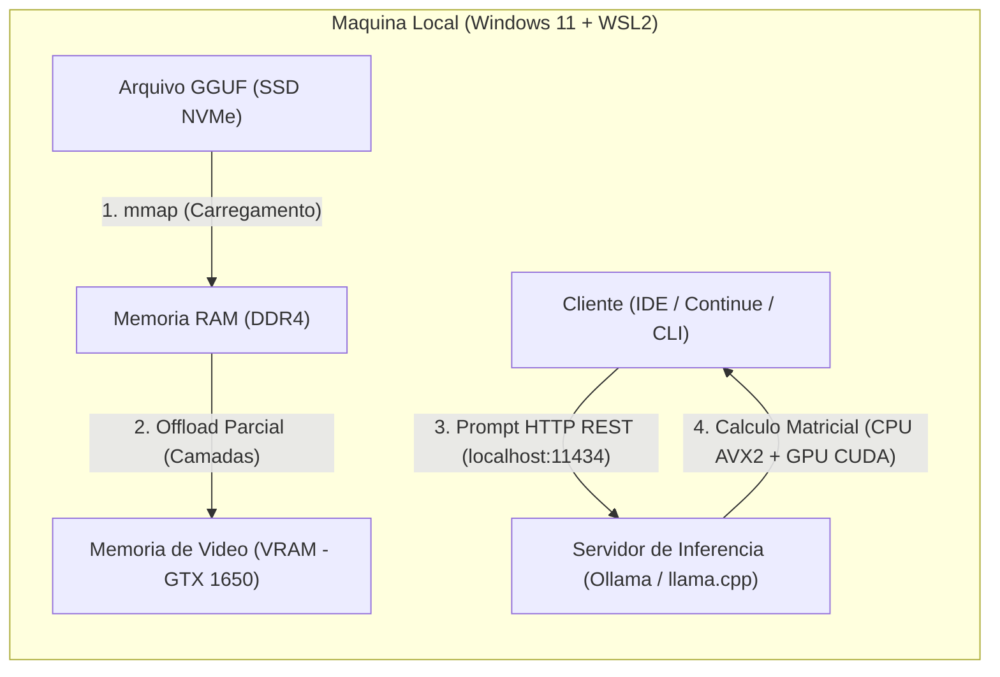

# Arquitetura e Requisitos de Execucao de Modelos de IA Localmente

Este guia detalha o funcionamento interno da inferencia de Grandes Modelos de Linguagem (LLMs) em hardware local, os requisitos de sistema (CPU, RAM, GPU, VRAM e largura de banda de memoria), e a governanca de onde versionar configuracoes e documentacoes no ecossistema de dotfiles.

---

## 1. Decisao Arquitetural: Onde Materializar esta Documentacao?

Para decidir entre `.dotfiles` (publico), repositorios privados corporativos (ex: `.dotfiles-privado`) ou a criacao de um novo repositorio dedicado (ex: `ai-local-docs`), foram avaliados os criterios de modularidade ja estabelecidos nas diretrizes do ambiente:

| Opcao | Escopo | Vantagens | Desvantagens | Veredito |
| :--- | :--- | :--- | :--- | :--- |
| **1. `.dotfiles` (Publico)** | Motor generico, Nix/Home Manager, WSL2, hardware pessoal e setups reproduziveis. | Centraliza a infraestrutura como codigo (`home.nix`) junto aos manuais de instalacao; portavel para qualquer máquina sem depender de VPN corporativa. | Nao deve conter prompts com regras de negocio internas ou nomes de sistemas sigilosos. | **ESCOLHIDO** para os manuais tecnicos, setup de maquinas e catalogo de modelos. |
| **2. Repositorio Privado Corporativo** | Contexto corporativo/institucional, manifests Git/SVN privados, rules e skills especificas. | Permite referenciar repositorios privados e fluxos internos de CI/CD. | Prende um conhecimento tecnico universal (inferencia local, hardware e comparativo de assinaturas) em um repo restrito. | Usar apenas para *rules/skills* de automacao corporativa restrita. |
| **3. Novo Repo Dedicado** | Repositorio exclusivo para estudos e configuracoes de IA local. | Isolamento total do tema. | Fragmenta a documentacao de bootstrap da maquina; exige clonar um terceiro repositorio ao formatar o PC, violando a reducao de carga cognitiva. | **Descartado** (gera dispersao e overhead de manutencao). |

### Regra de Ouro Adotada
- **Motor e Documentacao Tecnica (`.dotfiles/docs/`)**: Manuais de arquitetura, configuracao de WSL2/GPU nas maquinas Avell e Dell, catalogo de modelos GGUF/Ollama e matriz de decisao de assinaturas Cloud vs. Local.
- **Regras de Negocio e Governanca Interna (`repositorios privados`)**: Prompts especificos de conformidade e fluxos operacionais corporativos continuam isolados nas configuracoes privadas.

---

## 2. Como Funciona a Execucao de LLMs Localmente

Diferente do treinamento de modelos (que exige clusters de GPUs de datacenter), a **inferencia local** consiste apenas em passar um prompt por uma rede neural ja treinada (pesos congelados) para prever o proximo token.

### 2.1. As Duas Fases da Inferencia
Quando voce envia um arquivo de codigo para o modelo analisar, o hardware executa duas etapas distintas com gargalos diferentes:

1. **Prompt Processing (Prefill / Ingestao do Contexto)**:
   - O modelo le todos os tokens enviados no seu prompt (ex: um arquivo PHP de 300 linhas) de uma so vez em paralelo.
   - **Gargalo principal**: Poder de processamento bruto (**Compute-bound** — nucleos de CPU com instrucoes AVX2 ou nucleos CUDA da GPU).
   - **Impacto pratico**: Determina o "tempo ate a primeira palavra" (*Time to First Token* - TTFT). Em CPUs sem GPU dedicada, prompts muito longos (acima de 8k tokens) podem levar de 15 a 45 segundos apenas "lendo" antes de comecar a responder.

2. **Token Generation (Decoding / Geracao de Resposta)**:
   - O modelo gera a resposta **um token por vez**, de forma sequencial. Para gerar cada palavra nova, o processador precisa ler **todos os pesos do modelo** da memoria.
   - **Gargalo principal**: Largura de banda da memoria (**Memory Bandwidth-bound**).
   - **Impacto pratico**: Se um modelo ocupa 5 GB na memoria e voce quer gerar 10 tokens por segundo, sua memoria precisa transferir pelo menos 50 GB/s de dados continuamente para o processador.

---

## 3. Quantizacao (O Formato GGUF)

Modelos originais sao treinados em precisao de 16 bits (`FP16` ou `BF16`). Nessa precisao, cada **1 bilhao de parametros (1B)** exige **2 GB de memoria**. Um modelo de 7B exigiria 14 GB apenas para os pesos, inviabilizando GPUs de entrada e CPUs com 16 GB de RAM.

A **quantizacao** reduz a precisao dos pesos (para 8, 5 ou 4 bits) com perda minima de qualidade logica, empacotando o modelo no formato **GGUF** (otimizado para execucao hibrida CPU + GPU via `llama.cpp` e `Ollama`).

| Tipo de Quantizacao | Bits por Peso (Aprox.) | Tamanho de um Modelo 7B | Perda de Qualidade (Perplexidade) | Recomendacao de Uso |
| :--- | :--- | :--- | :--- | :--- |
| **FP16 (Original)** | 16.0 bits | ~14.0 GB | Zero (Referencia) | Inviavel localmente neste hardware. |
| **Q8_0** | 8.5 bits | ~7.5 GB | Praticamente zero | Excelente para modelos pequenos (1.5B a 3B) onde sobra RAM. |
| **Q5_K_M** | 5.7 bits | ~5.0 GB | Muito baixa | Otimo para modelos de 3B a 7B na maquina de 32 GB (Avell). |
| **Q4_K_M** | 4.8 bits | ~4.4 GB | Baixa (Sweet Spot) | **Padrao ouro recomendado**. Melhor equilibrio entre velocidade, uso de RAM e inteligencia. |
| **Q3_K_M / Q2_K** | 2.5 a 3.5 bits | ~2.8 a 3.3 GB | Alta (degrada logica de codigo) | **Evitar para programacao**. O modelo passa a alucinar sintaxe e esquecer instrucoes. |

---

## 4. Requisitos de Hardware e Formulas de Dimensionamento

### 4.1. Calculo de Consumo de Memoria (Pesos + KV Cache)
A memoria total consumida durante a execucao nao depende apenas do tamanho do arquivo `.gguf` no disco. Ela e composta por:

$$\text{Memoria Total} = \text{Tamanho do GGUF} + \text{KV Cache (Janela de Contexto)} + \text{Overhead do Runtime (\~500 MB)}$$

- **KV Cache (Key-Value Cache)**: E a "memoria de trabalho" onde o modelo guarda o historico da conversa atual. Cresce linearmente com o tamanho do contexto (`num_ctx`):
  - Contexto de `2048` tokens (2k): adiciona ~200 MB a 400 MB.
  - Contexto de `8192` tokens (8k): adiciona ~1.0 GB a 1.8 GB.
  - Contexto de `32768` tokens (32k): pode adicionar de **4 GB a 8 GB extras** de RAM/VRAM.

> [!IMPORTANT]
> **Regra pratica para maquinas de 16 GB a 32 GB de RAM**: Nunca deixe o contexto padrao aberto em 32k ou 128k localmente. Limite explicitamente `num_ctx` entre `4096` (4k) e `8192` (8k) para evitar estouro de memoria (OOM) e queda abrupta de velocidade.

### 4.2. Impacto do Canal de Memoria (Single-Channel vs. Dual-Channel)
Quando o modelo (ou parte dele) roda na RAM do sistema via CPU, a taxa de geracao de tokens e diretamente proporcional a largura de banda da DDR4:

- **DDR4-2666 em Dual-Channel (2 pentes)**: Largura de banda teorica de **~42.6 GB/s**. Permite que um modelo 7B (Q4_K_M, ~4.4 GB) gere entre **6 e 9 tokens/s** apenas na CPU.
- **DDR4-2666 em Single-Channel (1 pente unico)**: Largura de banda cai pela metade (**~21.3 GB/s**). O mesmo modelo 7B cai para **3 a 4.5 tokens/s** na CPU, pois os nucleos ficam ociosos esperando dados virem da memoria.
- **VRAM GDDR5/GDDR6 (ex: GTX 1650 4GB)**: Largura de banda de **128 GB/s a 192 GB/s** (3x a 4x mais rapida que a RAM DDR4 em Dual-Channel). Por isso, qualquer camada que couber na VRAM acelera drasticamente a resposta.

---

## 5. Stack de Software Recomendada (Ecossistema WSL2 + Nix)

Para manter o ambiente limpo, reproduzivel e alinhado ao padrao de terminal e VS Code / Antigravity IDE:

1. **Motor de Inferencia**: **Ollama** (rodando como servico systemd dentro do WSL2 Ubuntu 24.04 / 26.04, ou gerenciado via Nix).
   - Encapsula o `llama.cpp`, gerencia o download de modelos GGUF, detecta automaticamente a GPU NVIDIA via driver WSLg/CUDA do Windows e expoe uma API compativel com OpenAI em `http://localhost:11434`.
2. **Integracao na IDE (VS Code / Antigravity IDE)**: Extensao **Continue** (`continue.continue`) ou **Cline**, apontando para `localhost:11434` apenas sob demanda (perfis isolados para nao consumir recursos em segundo plano).
3. **Uso via Terminal (Zero Overhead de UI)**: CLI nativa `ollama run <modelo>` ou scripts leves em Python/Bash que enviam `git diff` ou arquivos de documentacao diretamente para a API local e imprimem o parecer tecnico no terminal.

---

## Documentos Complementares

- [Guia de Configuracao por Maquina: Avell C62 LIV e Dell OptiPlex 7070](./ia-local-setup-maquinas.md)
- [Catalogo de Modelos Recomendados, Casos de Uso e Avaliacao de Assinaturas](./ia-local-modelos-e-assinaturas.md)

