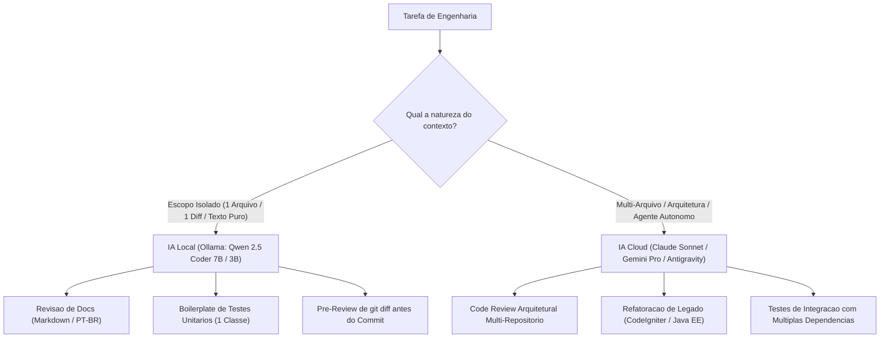
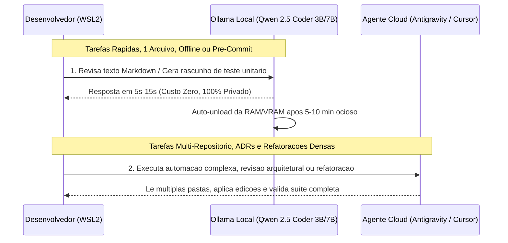

# Modelos de IA Recomendados, Casos de Uso e Avaliacao Estrategica de Assinaturas

Este documento mapeia os melhores modelos abertos (pesos locais via Ollama/GGUF) para as duas maquinas de trabalho (**Avell C62 LIV** e **Dell OptiPlex 7070**), avalia a viabilidade real das 4 frentes de engenharia (**Code Review, Geracao de Docs, Revisao de Docs e Testes Automatizados**) e analisa a relacao custo-beneficio entre **Gemini Pro, Claude Pro e Cursor Pro** na faixa de R$ 100 a R$ 150/mes em arquitetura hibrida.

---

## 1. Catalogo de Modelos Locais Recomendados por Maquina

Para manter baixa carga cognitiva e evitar acumular dezenas de gigabytes de modelos redundantes no SSD, a recomendacao foca nos **lideres absolutos de benchmark em codigo e texto em portugues** para a faixa de 1.5B a 14B parametros.

### 1.1. Matriz para o Avell C62 LIV (32 GB RAM Dual-Channel + GTX 1650 4 GB VRAM)

| Categoria | Modelo (Tag Ollama) | Tamanho (Q4_K_M) | Onde Roda | Velocidade Estimada | Quando Usar |
| :--- | :--- | :--- | :--- | :--- | :--- |
| **Ultra-Rapido (Autocomplete / FIM)** | `qwen2.5-coder:1.5b` ou `qwen2.5-coder:3b` | 1.0 GB a 1.9 GB | **100% VRAM (GTX 1650)** | **35 a 65 tokens/s** | Autocomplete inline na IDE (Continue), explicar regex, gerar comandos shell/docker rapidos. |
| **Padrao Ouro Diario (Codigo e Testes)** | `qwen2.5-coder:7b` | ~4.7 GB | **Hibrido** (~3.2 GB VRAM + ~2 GB RAM) | **12 a 18 tokens/s** | **Melhor escolha geral no Avell**. Gerar testes unitarios (Pest/JUnit), refatorar funcoes isoladas e revisar diffs curtos. |
| **Redacao e Revisao PT-BR (Docs)** | `llama3.1:8b` ou `gemma2:9b` | 4.7 GB a 5.4 GB | **Hibrido** (GPU + RAM Dual-Channel) | **9 a 14 tokens/s** | Revisao ortografica/gramatical de Markdown, padronizacao de CHANGELOG, reescrita clara de ADRs e manuais. |
| **Raciocinio Logico (Code Review Denso)** | `deepseek-r1:7b` (Distill Qwen 7B) | ~4.7 GB | **Hibrido** (GPU + RAM Dual-Channel) | **10 a 15 tokens/s** | Encontrar bugs sutis de logica, condicoes de corrida ou falhas de validacao em um metodo especifico (usa *Chain-of-Thought*). |
| **Teto Maximo da Maquina (Offline Pesado)** | `qwen2.5-coder:14b` | ~9.0 GB | **25% GPU / 75% RAM** | **4.5 a 6.5 tokens/s** | Uso exclusivo quando estiver sem internet ou para analisar codigo sigiloso complexo. Lento, mas com qualidade proxima ao GPT-4o-mini. |

---

### 1.2. Matriz para o Dell OptiPlex 7070 (i9-9900 8C/16T + 16 GB RAM Single-Channel, Sem GPU)

No Dell, o gargalo nao e o processador (o i9-9900 e forte), mas sim os **16 GB de RAM em Single-Channel (~21.3 GB/s)** divididos com Windows 11 e Docker.

| Categoria | Modelo (Tag Ollama) | Tamanho (Q4_K_M) | Consumo de RAM Total | Velocidade Estimada (Single-Channel) | Velocidade se Fizer Upgrade p/ Dual-Channel (32GB) | Quando Usar |
| :--- | :--- | :--- | :--- | :--- | :--- | :--- |
| **Diario Seguro (Com Docker Ligado)** | `qwen2.5-coder:3b` | ~1.9 GB | ~2.6 GB | **11 a 15 tokens/s** | **22 a 28 tokens/s** | **Modelo padrao no Dell**. Cabe com folga nos 16 GB mesmo com containers Laravel/Postgres rodando. |
| **Revisao de Texto Ultra-Leve** | `llama3.2:3b` | ~2.0 GB | ~2.7 GB | **11 a 15 tokens/s** | **22 a 28 tokens/s** | Revisar textos em Markdown, resumir notas, formatar tabelas e limpar documentacao. |
| **Teto com Docker Desligado** | `qwen2.5-coder:7b` | ~4.7 GB | ~5.8 GB | **4.0 a 5.5 tokens/s** | **8.0 a 10.5 tokens/s** | Usar apenas para gerar esqueletos de testes ou revisar um arquivo unico quando a memoria do sistema estiver livre. |
| **Embeddings / Busca Semantica Local** | `nomic-embed-text` | ~274 MB | ~400 MB | Instantaneo | Instantaneo | Indexacao local da codebase ou de documentacoes tecnicas/wikis sem custo de API e com gasto desprezivel de RAM. |

---

## 2. Viabilidade por Caso de Uso (Realidade Tecnica vs. Expectativa)

Avaliacao honesta do que os modelos locais de **3B a 7B** conseguem entregar nas duas maquinas frente a um fluxo de trabalho corporativo diversificado (PHP/Laravel, CodeIgniter, Java/Spring Boot, documentacoes tecnicas e testes):

### 2.1. Revisao de Documentacao (Ortografia, Clareza, Padronizacao Markdown)
- **Adequacao Local**: **EXCELENTE (9/10)** — Tanto no Avell (7B/8B) quanto no Dell (3B).
- **Por que funciona bem**: Revisar um arquivo `.md` de documentacao ou um `README.md` exige contexto curto (1k a 3k tokens) e nao depende de conhecer outros 50 arquivos do projeto.
- **Como usar**: Passar o texto para `llama3.1:8b` (Avell) ou `qwen2.5-coder:3b` (Dell) pedindo para remover emojis, corrigir concordancia em PT-BR e converter diagramas ASCII simples em sintaxe Mermaid basica.

### 2.2. Geracao de Documentacao (Docblocks, Comentarios, Esqueleto de Changelog)
- **Adequacao Local**: **MUITO BOA para escopo local (7.5/10)** | **FRACA para arquitetura macro (3/10)**.
- **O que fazer localmente**:
  - Gerar PHPDoc / Javadoc de uma classe ou Controller aberto.
  - Transformar a saida do `git log --oneline tag..HEAD` em rascunho categorizado (`### Adicionado`, `### Corrigido`) seguindo o padrao Keep a Changelog.
- **O que NAO fazer localmente**: Pedir para um modelo 7B local "ler o repositorio inteiro e gerar uma ADR completa". O limite de contexto (4k-8k) e o tempo de prefill na CPU/GTX 1650 tornam isso inviavel.

### 2.3. Geracao de Testes Automatizados (PestPHP, PHPUnit, JUnit 5)
- **Adequacao Local**: **BOA para Testes Unitarios / Boilerplate (7/10)** | **LIMITADA para Feature Tests complexos (4/10)**.
- **Por que**: O `qwen2.5-coder:7b` conhece muito bem a sintaxe do PestPHP (`it('should...', function () {})`) e do JUnit 5 + Mockito.
- **Fluxo ideal**: Voce cola **apenas o Service ou Controller + o Model/DTO correspondente** (2 arquivos curtos) e pede: *"Gere o esqueleto de testes Pest para os caminhos felizes e excecoes de validacao deste metodo"*. Ele gera 80% do trabalho bracal (setup, mocks, asserts) gratuitamente offline, e voce (ou a IA Cloud) apenas refina.

### 2.4. Code Review (Revisao de Codigo)
- **Adequacao Local**: **BOA como Linter Semantico de Diffs Curtos (6.5/10)** | **INSUFICIENTE para Revisao de Conformidade Estrutural (3/10)**.
- **O que o modelo local faz bem**: Analisar um `git diff --staged` de ate 150 linhas e apontar: variaveis nao utilizadas, falta de tratamento de `null`, queries N+1 evidentes dentro de loops, ou violacoes simples de PSR-12 / SOLID.
- **Onde o modelo local falha**: Ele nao consegue manter na memoria simultaneamente templates base, regras de governanca e o projeto alvo para fazer uma auditoria estrutural (tarefa que exige janelas de 100k+ tokens e raciocinio de fronteira como Claude Sonnet ou Gemini Pro).

---

## 3. Avaliacao Estrategica de Assinaturas (Faixa de R$ 100 a R$ 150/mes)

Voce atualmente possui assinatura do **Gemini Pro** e avalia tres caminhos:
1. Descontinuar e ficar apenas com modelos locais;
2. Migrar para **Cursor Pro** (~US$ 20/mes ≈ R$ 115 - R$ 125 + IOF);
3. Migrar para **Claude Pro** (~US$ 20/mes ≈ R$ 115 - R$ 125 + IOF) ou manter o ecossistema atual.

### 3.1. Veredito 1: Vale a pena cancelar tudo e ficar 100% nos modelos locais?
**NAO.** Pelas especificacoes do seu hardware (GTX 1650 4GB no Avell e CPU-only Single-Channel no Dell), os modelos locais sao **assistentes taticos de escopo curto (1 arquivo por vez)**.
- Seu trabalho de engenharia envolve **sistemas corporativos distribuidos, refatoracao de monolitos legados, revisao de conformidade multi-repositorio e execucao de automacoes agenticas na IDE**.
- Tentar fazer isso apenas com modelos de 3B/7B locais causara **alta frustracao, lentidao de espera (20s a 40s por prompt) e sobrecarga cognitiva**, pois voce tera que alimentar contexto manualmente pedaco por pedaco.

### 3.2. Comparativo Direto: Gemini Pro vs. Claude Pro vs. Cursor Pro

| Criterio | Google Gemini Pro (Ecossistema Atual / Antigravity) | Anthropic Claude Pro (Web + Claude Code) | Cursor Pro (IDE dedicada — US$ 20/mes) |
| :--- | :--- | :--- | :--- |
| **Custo Mensal Estimado** | ~R$ 97 a R$ 120/mes | US$ 20/mes (~R$ 120/mes) | US$ 20/mes (~R$ 120/mes) |
| **Janela de Contexto Real** | **Massiva (1M a 2M tokens)**. Le repositorios inteiros, logs gigantes e multiplas documentacoes sem perder o fio. | **200k tokens**. Excelente precisao, mas esgota rapido em conversas longas com muitos arquivos. | **Variavel** (usa cortes inteligentes de contexto para economizar creditos das 500 requisicoes rapidas). |
| **Qualidade em Codigo (PHP, Java, React, Testes)** | **Muito Alta** (especialmente integrado ao harness de rules/skills configurado na IDE). | **Estado da Arte (Referencia de Mercado)**. Os modelos Claude Sonnet/Opus sao imbatíveis em refatoracao cirurgica, código limpo e aderencia estrita a instrucoes negativas. | **Estado da Arte na IDE** (permite escolher Claude Sonnet, Gemini Pro ou GPT-4o dentro do proprio editor). |
| **Limites de Uso (Rate Limits)** | **Muito generosos**. Raramente bloqueia o turno de trabalho no meio da tarde. | **Restritivos em horario de pico**. Conversas longas em projetos grandes podem atingir o limite de mensagens a cada 5 horas rapidamente. | **500 fast requests/mes** incluidos (depois cai na fila lenta ilimitada ou cobra por uso extra). |
| **Impacto no seu Workflow Atual (`.dotfiles` e ambiente)** | **Zero atrito**. Todo o seu harness (regras persistentes, skills customizadas, historico) ja foi construído e integrado ao ambiente. | Exigiria usar via navegador (copia e cola manual, gerando distracao e perda de foco) ou pagar creditos extras de API para usar no terminal/IDE. | O Cursor e um fork do VS Code (assim como o Antigravity). Aceita seus `.code-workspace`, extensoes e WSL2, mas exigiria migrar suas `rules` e `skills` para `.cursor/rules/`. |

### 3.3. Recomendacao Estrategica para o Seu Perfil

Considerando sua rotina técnica e a necessidade de **minimizacao de atrito cognitivo, automacao de tarefas repetitivas e eliminacao de copia-e-cola manual entre janelas**:

1. **Se você utiliza o Antigravity IDE como ambiente principal (e sua assinatura Gemini Pro destrava os modelos avançados nele)**:
   - **Mantenha o ecossistema integrado na IDE**. O maior ativo que você construiu nos últimos meses não é apenas o modelo, mas o **Engineering Harness** (regras persistentes de arquitetura, skills sob demanda de governanca e versionamento).
2. **Se você quiser testar uma mudança dentro dos R$ 100 - R$ 150/mês**:
   - **Prefira o Cursor Pro (US$ 20) em vez do Claude Pro avulso na Web**.
   - **Por quê?**: O Claude Pro na web obriga você a sair do código, copiar arquivos para o navegador e colar de volta — isso gera distração e fadiga de atenção dividida. Já o **Cursor Pro** entrega acesso aos modelos **Claude Sonnet** e **Gemini** diretamente dentro da IDE (conectada ao seu WSL2), mantendo o fluxo em tela única.
3. **Como usar a IA Local (Ollama) para economizar sua cota Cloud**:
   - Mesmo mantendo uma assinatura de R$ 120/mês (seja Gemini/Antigravity ou Cursor Pro), use o **Ollama local** como seu **"filtro de primeiro nível"**:
     - **No terminal (`git diff` rápido)**: Antes de abrir um chat pesado na nuvem, use o modelo local (`qwen2.5-coder:7b` no Avell ou `3b` no Dell) para revisar pequenos commits, explicar erros de sintaxe ou formatar documentacoes Markdown.
     - **Offline / Instabilidade de Rede**: Quando estiver desconectado ou com instabilidade de rede externa, o modelo local garante autonomia total para continuar gerando testes e documentando código.

---

## 4. Fluxo de Trabalho Hibrido Recomendado (Passo a Passo Sem Atrito)

Para integrar a IA local ao seu dia a dia sem poluir a memória RAM nem criar distração visual:

---

## Documentos Relacionados

- [Arquitetura e Requisitos de Execucao de Modelos de IA Localmente](./ia-local-arquitetura-e-requisitos.md)
- [Guia de Configuracao por Maquina: Avell C62 LIV e Dell OptiPlex 7070](./ia-local-setup-maquinas.md)

