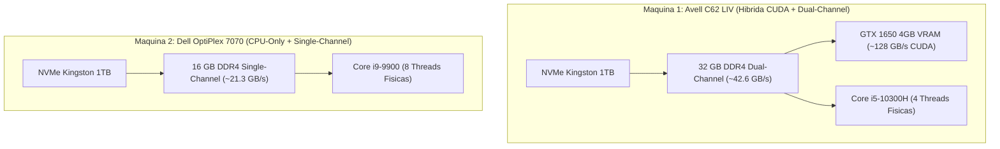

# Guia de Configuracao de IA Local por Maquina (Avell C62 LIV e Dell OptiPlex 7070)

Este manual contem o diagnostico de hardware extraido via HWiNFO64 e o passo a passo reproduzivel para configurar a execucao de modelos de IA localmente nas duas maquinas principais de trabalho sob **Windows 11 Pro + WSL2 (Ubuntu 24.04 / 26.04)**.

---

## 1. Raio-X Comparativo das Maquinas (Baseado no HWiNFO64)

| Componente | Maquina 1: Notebook Avell C62 LIV | Maquina 2: Desktop Dell OptiPlex 7070 | Impacto na Inferencia de IA Local |
| :--- | :--- | :--- | :--- |
| **Processador (CPU)** | Intel Core i5-10300H (Comet Lake-H, 45W)<br>• **4 Nucleos Fisicos / 8 Threads**<br>• Base: 2.50 GHz / Turbo: 4.50 GHz<br>• Cache L3: **8 MB** | Intel Core i9-9900 (Coffee Lake-S, 65W)<br>• **8 Nucleos Fisicos / 16 Threads**<br>• Base: 3.10 GHz / Turbo: 5.00 GHz<br>• Cache L3: **16 MB** | O **Dell i9-9900 tem o dobro de nucleos e cache L3**, processando a leitura inicial de prompts na CPU quase 2x mais rapido que o i5 do Avell. |
| **Instrucoes Vetoriais** | AVX, AVX2, FMA3 (Sem AVX-512) | AVX, AVX2, FMA3 (Sem AVX-512) | Ambos suportam aceleracao matricial AVX2/FMA no `llama.cpp`. |
| **Memoria RAM** | **32 GB DDR4-2666** (1333 MHz)<br>• Modo: **Canal Duplo (Dual-Channel)**<br>• Timings: 19-19-19-43 | **16 GB DDR4-2666** (1333 MHz)<br>• Modo: **Canal Unico (Single-Channel)**<br>• 1x 16GB Smart Modular (19-19-19-43) | **Diferencial critico**: O Avell tem 32 GB em Dual-Channel (~42.6 GB/s). O Dell tem 16 GB em **Single-Channel** (~21.3 GB/s), o que estrangula a geracao de tokens em 50% por falta de largura de banda. |
| **Placa de Video (GPU)** | • Integrada: Intel UHD Graphics (Comet Lake)<br>• Dedicada: **NVIDIA GeForce GTX 1650 (4 GB VRAM GDDR5/GDDR6)** | • Integrada: **Intel UHD Graphics 630** (1 GB alocado)<br>• Dedicada: **Nenhuma** | A **GTX 1650 do Avell** possui ~128 GB/s de banda e nucleos CUDA. Modelos que cabem nos 4 GB de VRAM (1.5B a 3B) rodam de **35 a 60 tokens/s**, e modelos de 7B usam offload hibrido (GPU + RAM). |
| **Armazenamento** | • NVMe 1: Kingston SNV2S1000G (1 TB, PCIe x4 16 GT/s)<br>• NVMe 2: IM2P33F8BR2 (512 GB, PCIe x4 8 GT/s)<br>• SATA: ST1500DL001 (1.5 TB HDD) | • NVMe: Kingston SNV2S1000G (1 TB, PCIe x4 16 GT/s)<br>• Optico: DVD+-RW | Ambos contam com SSD NVMe Kingston de 1 TB (PCIe 4.0/3.0), garantindo carregamento quase instantaneo dos arquivos `.gguf` do disco para a RAM. |



---

## 2. Configuracao da Maquina 1: Avell C62 LIV (Com GPU GTX 1650)

O objetivo no Avell e aproveitar os **4 GB de VRAM da GTX 1650** para aceleracao total em modelos leves (3B) ou offload parcial de camadas (20 a 28 camadas na GPU + restante nos 32 GB de RAM Dual-Channel) em modelos de 7B a 14B.

### Passo 1: Validar Driver NVIDIA no Windows e Passthrough WSL2
1. No Windows 11, mantenha o driver Game Ready ou Studio da NVIDIA atualizado. **Nao instale drivers de video Linux completos dentro do Ubuntu WSL** (o WSL2 usa o driver do Windows via `/dev/dxg` e biblioteca `libcuda.so`).
2. Dentro do terminal do WSL (Ubuntu 24.04 ou 26.04), valide se a GTX 1650 esta visivel:
   ```bash
   nvidia-smi
   ```
   > **Criterio de conclusao**: A tabela deve exibir `NVIDIA GeForce GTX 1650` com `4096MiB` de memoria total.

### Passo 2: Configurar `.wslconfig` no Windows (Avell — 32 GB RAM)
No Windows, edite ou crie o arquivo `%USERPROFILE%\.wslconfig` via PowerShell ou Bloco de Notas para garantir memoria folgada aos containers Docker e ao Ollama:

```ini
[wsl2]
memory=22GB
processors=8
swap=8GB
localhostForwarding=true
```
> Apos salvar, caso altere o arquivo, reinicie o WSL em um terminal PowerShell com `wsl --shutdown`.

### Passo 3: Instalar e Configurar o Servidor Ollama no WSL2
Execute no terminal do Ubuntu (WSL):

```bash
curl -fsSL https://ollama.com/install.sh | sh
```

O instalador detectara a GPU NVIDIA e criara o servico `ollama.service` no systemd do WSL.

### Passo 4: Ajustar Variaveis de Otimizacao para a GTX 1650 (4 GB VRAM)
Com 4 GB de VRAM e 2 monitores Ultrawide (2560x1080) conectados no Windows, o proprio sistema operacional ja consome cerca de 600 MB a 900 MB da VRAM. Para evitar estouro de memoria de video e ativar **Flash Attention** e **Quantizacao do KV Cache**:

```bash
sudo mkdir -p /etc/systemd/system/ollama.service.d
sudo tee /etc/systemd/system/ollama.service.d/override.conf << 'EOF'
[Service]
Environment="OLLAMA_FLASH_ATTENTION=1"
Environment="OLLAMA_KV_CACHE_TYPE=q8_0"
Environment="OLLAMA_NUM_PARALLEL=1"
Environment="OLLAMA_MAX_LOADED_MODELS=1"
Environment="OLLAMA_KEEP_ALIVE=10m"
EOF

sudo systemctl daemon-reload
sudo systemctl restart ollama
```

**Por que essas flags sao fundamentais na GTX 1650?**
- `OLLAMA_FLASH_ATTENTION=1`: Reduz drasticamente o uso de VRAM ao expandir o contexto.
- `OLLAMA_KV_CACHE_TYPE=q8_0`: Comprime a memoria de contexto pela metade (de 16 bits para 8 bits) com perda insignificante de precisao, fazendo caber mais camadas do modelo dentro dos 4 GB da GTX 1650.
- `OLLAMA_NUM_PARALLEL=1` e `OLLAMA_MAX_LOADED_MODELS=1`: Garante que apenas 1 requisicao e 1 modelo ocupem a VRAM por vez.
- `OLLAMA_KEEP_ALIVE=10m`: Descarrega o modelo da VRAM/RAM automaticamente apos 10 minutos sem uso, liberando recursos para o Docker e IDEs.

### Passo 5: Regra de Ouro de Threads na CPU do Avell (Caso haja Offload Hibrido)
O Core i5-10300H possui **4 nucleos fisicos** e 8 threads (Hyper-Threading). Em inferencia de LLMs, usar threads virtuais (HT) gera contencao de cache e reduz a performance.
- Sempre que criar um `Modelfile` customizado no Avell, defina `PARAMETER num_thread 4`.

---

## 3. Configuracao da Maquina 2: Dell OptiPlex 7070 (i9-9900, 16 GB Single-Channel, Sem GPU)

O Dell OptiPlex 7070 possui um excelente processador de 8 nucleos fisicos (**Core i9-9900 com 16 MB de Cache L3**), mas opera com duas restricoes severas reveladas pelo HWiNFO64:
1. **Apenas 16 GB de RAM total** (compartilhada entre Windows 11, navegador, VS Code/Antigravity, containers Docker e WSL2).
2. **Memoria em Canal Unico (Single-Channel)** — apenas o slot `DIMM1` esta populado com um pente de 16 GB (`SF4642G8CK8I8HLSBG`).

> [!TIP]
> **Recomendacao de Upgrade Fisico de Altissimo Retorno no Dell**:
> Adicionar um segundo pente de **16 GB DDR4-2666 UDIMM** no slot par da placa-mae `DELL 07VWPG` (Chipset Q370) fara duas coisas simultaneamente:
> 1. Ativara o **Dual-Channel**, **dobrando imediatamente a velocidade de geracao de tokens** na CPU (de ~21.3 GB/s para ~42.6 GB/s).
> 2. Elevara a memoria para **32 GB**, eliminando o risco de travamento quando o Docker Compose e a IA rodarem juntos.

### Passo 1: Configurar `.wslconfig` no Windows (Dell — 16 GB RAM)
Como a maquina possui apenas 16 GB fisicos, o WSL2 nao deve ultrapassar 10 GB para nao causar paginacao de disco no host Windows 11:

```ini
[wsl2]
memory=10GB
processors=8
swap=6GB
localhostForwarding=true
```

### Passo 2: Instalar o Ollama em Modo CPU-Only no WSL2
Execute no terminal do Ubuntu (WSL):

```bash
curl -fsSL https://ollama.com/install.sh | sh
```
> O instalador informara `WARNING: No NVIDIA/AMD GPU detected. Ollama will run in CPU-only mode.` — este e o comportamento esperado para a Intel UHD Graphics 630.

### Passo 3: Otimizar o Servico do Ollama para o Core i9-9900 e Pouca RAM
No Dell, precisamos liberar a memoria RAM rapidamente apos cada uso (`KEEP_ALIVE=5m`) e comprimir o cache:

```bash
sudo mkdir -p /etc/systemd/system/ollama.service.d
sudo tee /etc/systemd/system/ollama.service.d/override.conf << 'EOF'
[Service]
Environment="OLLAMA_FLASH_ATTENTION=1"
Environment="OLLAMA_KV_CACHE_TYPE=q8_0"
Environment="OLLAMA_NUM_PARALLEL=1"
Environment="OLLAMA_MAX_LOADED_MODELS=1"
Environment="OLLAMA_KEEP_ALIVE=5m"
EOF

sudo systemctl daemon-reload
sudo systemctl restart ollama
```

### Passo 4: Regra de Ouro de Threads na CPU do Dell (8 Nucleos Fisicos)
O Intel Core i9-9900 possui **8 nucleos fisicos** e 16 threads. Para extrair a maxima performance das unidades vetoriais AVX2 sem saturar o barramento de memoria Single-Channel:
- Configure os modelos para usar exatamente **8 threads** (`PARAMETER num_thread 8`).

---

## 4. Criacao de Perfis de Modelos Otimizados (`Modelfile`)

Para nao precisar lembrar parametros de contexto e threads a cada execucao, crie perfis locais otimizados em cada maquina.

### 4.1. Perfil para o Avell C62 LIV (7B Hibrido GPU + CPU)
Execute no terminal do Avell:

```bash
# Baixa o Qwen 2.5 Coder 7B (Q4_K_M - ~4.7 GB)
ollama pull qwen2.5-coder:7b

# Cria versao ajustada para os 4 nucleos fisicos do i5-10300H e contexto de 8k
cat << 'EOF' > /tmp/Modelfile.avell-7b
FROM qwen2.5-coder:7b
PARAMETER num_ctx 8192
PARAMETER num_thread 4
PARAMETER temperature 0.2
EOF

ollama create coder-avell:7b -f /tmp/Modelfile.avell-7b
```

### 4.2. Perfil para o Dell OptiPlex 7070 (3B / 7B Otimizado para i9-9900 e 16GB RAM)
Execute no terminal do Dell:

```bash
# Opcao Rapida (Recomendada com Docker ligado): Qwen 2.5 Coder 3B (~1.9 GB)
ollama pull qwen2.5-coder:3b

cat << 'EOF' > /tmp/Modelfile.dell-3b
FROM qwen2.5-coder:3b
PARAMETER num_ctx 4096
PARAMETER num_thread 8
PARAMETER temperature 0.2
EOF

ollama create coder-dell:3b -f /tmp/Modelfile.dell-3b
```

Caso os containers Docker estejam desligados (`docker compose down`) e voce queira usar o modelo de 7B no Dell para uma revisao pontual mais densa:

```bash
ollama pull qwen2.5-coder:7b

cat << 'EOF' > /tmp/Modelfile.dell-7b
FROM qwen2.5-coder:7b
PARAMETER num_ctx 4096
PARAMETER num_thread 8
PARAMETER temperature 0.2
EOF

ollama create coder-dell:7b -f /tmp/Modelfile.dell-7b
```

---

## 5. Comandos Rapidos de Operacao e Diagnostico no Dia a Dia

| Objetivo | Comando no Terminal (WSL) | O que observar |
| :--- | :--- | :--- |
| **Verificar onde o modelo esta rodando (CPU vs GPU)** | `ollama ps` | Na coluna `PROCESSOR`, verifique a proporcao `XX% CPU / YY% GPU`. No Avell com modelo 3B deve mostrar `100% GPU`; com 7B deve mostrar ~`40% CPU / 60% GPU`. |
| **Liberar memoria RAM/VRAM imediatamente** | `ollama stop <nome-do-modelo>` | Descarrega o modelo na hora antes de subir uma stack pesada do Docker Compose. |
| **Medir velocidade real (Tokens/s)** | `ollama run coder-avell:7b --verbose "Explique SOLID em 5 linhas"` | Ao final da resposta, exibe `eval rate: XX.XX tokens/s` (velocidade de geracao) e `prompt eval rate` (velocidade de leitura). |
| **Listar modelos instalados no SSD** | `ollama list` | Mostra o espaco ocupado em `/usr/share/ollama/.ollama/models`. |

---

## 6. Onde Armazenar os Modelos no Avell C62 LIV (3 Discos)

O Avell possui tres unidades de armazenamento:
1. `KINGSTON SNV2S1000G` (1 TB NVMe PCIe x4 16.0 GT/s — ~3500 MB/s)
2. `IM2P33F8BR2` (512 GB NVMe PCIe x4 8.0 GT/s — ~1800 MB/s)
3. `ST1500DL001` (1.5 TB HDD SATA 3 Gb/s — ~100 MB/s, com alerta de saude no HWiNFO64)

> [!CAUTION]
> **Nunca armazene o VHDX do WSL2 nem os modelos do Ollama no HD mecanico de 1.5 TB (`ST1500DL001`)**. Alem de reduzir o carregamento do modelo de 1 segundo para mais de 40 segundos, a unidade apresenta alerta amarelo S.M.A.R.T. no HWiNFO64. Mantenha a distro WSL2 no NVMe Kingston de 1 TB ou no NVMe de 512 GB, e SEMPRE dentro do filesystem nativo Linux (`/usr/share/ollama` ou `~/.ollama`), nunca em `/mnt/c/` ou `/mnt/d/` (onde o protocolo 9P do WSL degrada o I/O em ate 10x).

---

## Documentos Relacionados

- [Arquitetura e Requisitos de Execucao de Modelos de IA Localmente](./ia-local-arquitetura-e-requisitos.md)
- [Catalogo de Modelos Recomendados, Casos de Uso e Avaliacao de Assinaturas](./ia-local-modelos-e-assinaturas.md)

